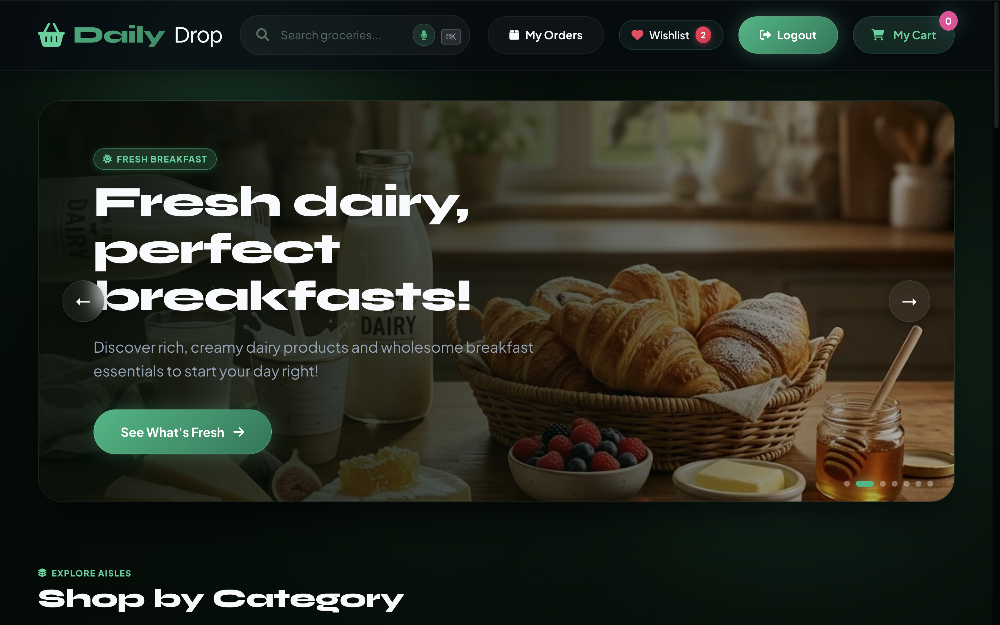
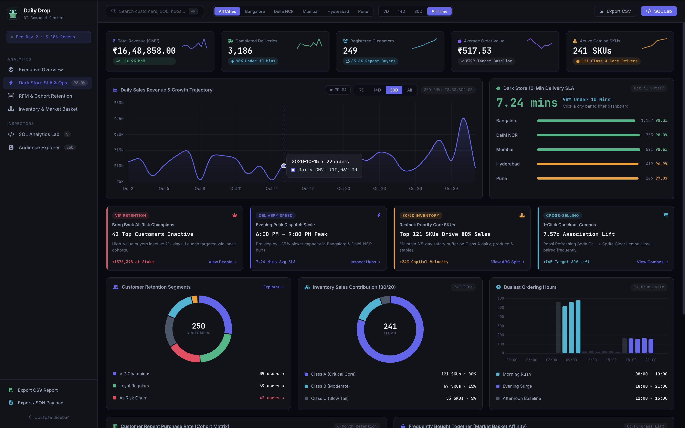
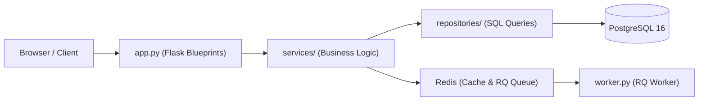

# DailyDrop 🛒 — Full-Stack Quick-Commerce Web Application

[](https://github.com/Spidey173/Dailydrop/actions)
[](tests/)
[](app.py)
[](core/database.py)
[](docker-compose.yml)
[](LICENSE)

**DailyDrop** is a full-stack quick-commerce web application built with Python, Flask, and PostgreSQL. It simulates a 10-minute grocery and daily-essentials delivery platform featuring a customer storefront, Razorpay checkout, inventory management, and an admin analytics dashboard.

🔗 **[Live Storefront](https://dailydrop18.vercel.app/)** · 🛡️ **[Admin Portal](https://dailydrop18.vercel.app/admin_login)** · 📊 **[Analytics Dashboard](https://dailydrop16.vercel.app/)** · 🩺 **[Health Check](https://dailydrop18.vercel.app/healthz)** · 📦 **[GitHub Repository](https://github.com/Spidey173/Dailydrop)**

---

## ✨ Features

- **User Authentication:** Secure registration, login, and session management for customers and admins.
- **Product Browsing & Categories:** Browse 241 seeded grocery items with category filtering and search (`/api/v1/products`).
- **Shopping Cart & Pricing:** Add/update items with server-side price calculation and delivery fee rules.
- **Order Placement & Tracking:** End-to-end checkout flow with order history and status progression.
- **Payment Integration:** Razorpay checkout with server-side signature verification and demo payment support.
- **Admin Dashboard & Inventory:** Manage catalog stock, track orders, and monitor delivery SLA metrics.
- **Business Analytics:** Built-in RFM customer segmentation, cohort retention, ABC inventory analysis, and market basket insights.

---

## 🛠️ Tech Stack

- **Backend:** Python 3.11+, Flask 3, Gunicorn
- **Database & Cache:** PostgreSQL 16 (Neon / Docker), Redis (with in-memory fallback)
- **Frontend:** Jinja2 Templates, HTML5, CSS3, Vanilla JavaScript, Chart.js
- **Payments & Background Jobs:** Razorpay API, RQ (Redis Queue)
- **DevOps & Quality:** Docker, Docker Compose, Vercel, GitHub Actions, Pytest, Testcontainers, Ruff, Black

---

## 📸 Screenshots

| Storefront & Catalog | Admin Analytics Dashboard |
| :---: | :---: |
|  |  |

---

## 🏗️ Architecture



- **`core/`:** Configuration (`config.py`), PostgreSQL connection pool (`database.py`), Flask extensions (`extensions.py`), and shared utilities (`utils.py`).
- **`blueprints/`:** HTTP route handlers (`main`, `auth`, `products`, `cart`, `admin`).
- **`services/` & `repositories/`:** Layered business logic and parameterized PostgreSQL access.
- **API Endpoints:** Product catalog REST endpoint at `/api/v1/products` and health probe at `/healthz`.

---

## 🚀 Setup & Running

### Option 1: Docker Compose (Recommended — Windows, macOS & Linux)
```bash
git clone https://github.com/Spidey173/Dailydrop.git
cd Dailydrop
cp .env.example .env      # Windows CMD: copy .env.example .env
docker compose up --build
```
- Storefront: `http://localhost:5000`
- Health Check: `http://localhost:5000/healthz`

### Option 2: Local Python Setup (Windows, macOS & Linux)
```bash
git clone https://github.com/Spidey173/Dailydrop.git
cd Dailydrop

# 1. Create & activate virtual environment
python -m venv venv
# macOS / Linux:  source venv/bin/activate
# Windows (CMD):  venv\Scripts\activate.bat
# Windows (PS):   .\venv\Scripts\Activate.ps1

# 2. Install dependencies & configure env
pip install -r requirements.txt -r requirements-dev.txt
cp .env.example .env      # Windows CMD: copy .env.example .env

# 3. Migrate, seed, and start server
python -m migrations.runner
python seed.py
python app.py
```

> _On macOS/Linux, you can also use `make migrate`, `make seed`, and `make run`._

### Environment Variables
See [`.env.example`](.env.example) for all supported keys:
- `DATABASE_URL` — PostgreSQL connection string
- `SECRET_KEY` — Flask session & CSRF secret
- `FLASK_ENV` — `development`, `testing`, or `production`
- `REDIS_URL` / `REDIS_ENABLED` — Optional Redis connection (falls back to in-memory if unavailable)
- `RAZORPAY_KEY_ID` / `RAZORPAY_KEY_SECRET` / `RAZORPAY_WEBHOOK_SECRET` — Optional Razorpay credentials

---

## 🧪 Testing & Linting

```bash
# Install dev & test dependencies (includes pytest, testcontainers, ruff, black)
pip install -r requirements-dev.txt

# Run full Pytest suite (110 tests; requires Docker running on Windows/macOS/Linux)
pytest -v

# Run Ruff linter & Black formatter (works on all OS; or `make lint` / `make format` on macOS/Linux)
ruff check .
black .
```

---

## 🔑 Demo Credentials

| Role | Email | Password | Login Path |
| :--- | :--- | :--- | :--- |
| **Customer** | `demo_dailydrop@gmail.com` | `Demouser@123` | `/login` |
| **Admin** | `admin_dailydrop@gmail.com` | `Dailydrop@173` | `/admin_login` |

---

## 📁 Project Structure

```text
Dailydrop/
├── api/index.py          # Vercel serverless entry point
├── app.py                # Flask application factory & WSGI entry point
├── worker.py             # RQ background worker
├── core/                 # Config, database pool, extensions, utilities
├── blueprints/           # Route controllers (auth, products, cart, admin, main)
├── services/             # Business logic (orders, payments, inventory, Redis)
├── repositories/         # PostgreSQL data access & analytics queries
├── migrations/           # Versioned SQL schema migrations
├── seeds/                # Canonical 241-item catalog & seed script
├── scripts/              # Helper scripts (run.sh, run_tests.sh)
├── analytics/            # Offline BI scripts, SQL queries, CSVs, notebook
├── static/ & templates/  # Frontend assets & Jinja2 HTML templates
├── tests/                # 110 automated Pytest tests
├── Makefile              # Common run, test, lint, and format commands
└── pyproject.toml        # Project metadata, Ruff, and Black configuration
```

---

## 📄 License

This project is open-source under the [MIT License](LICENSE).
